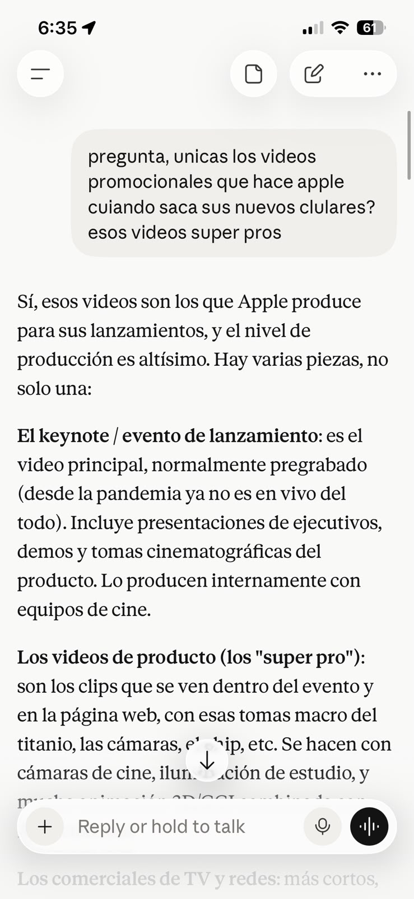
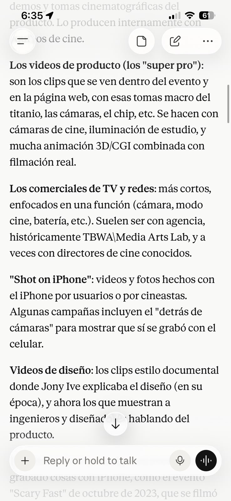
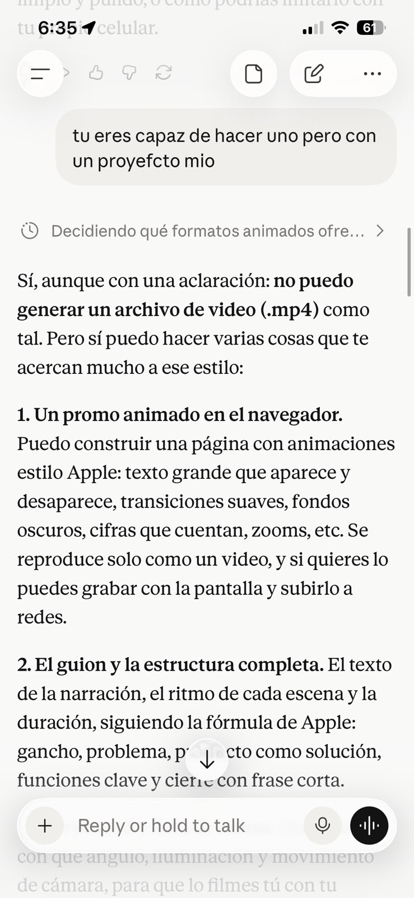
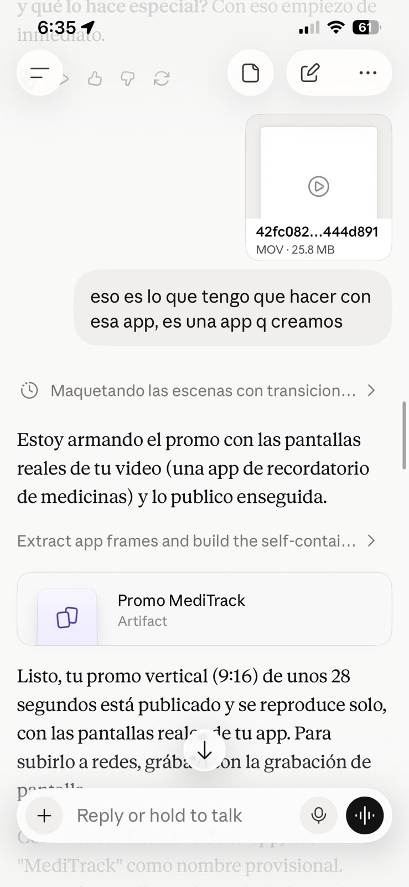
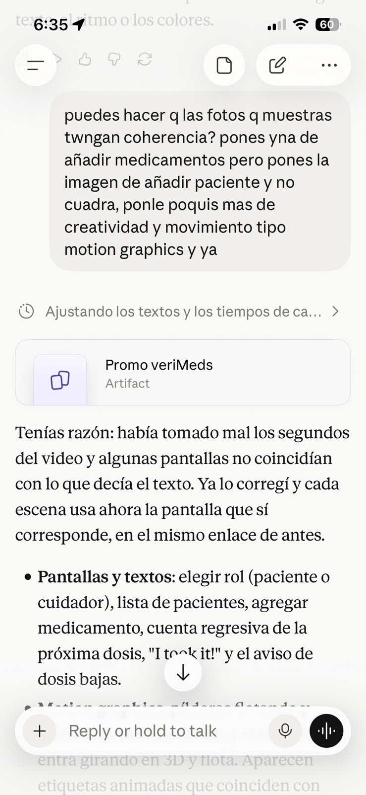
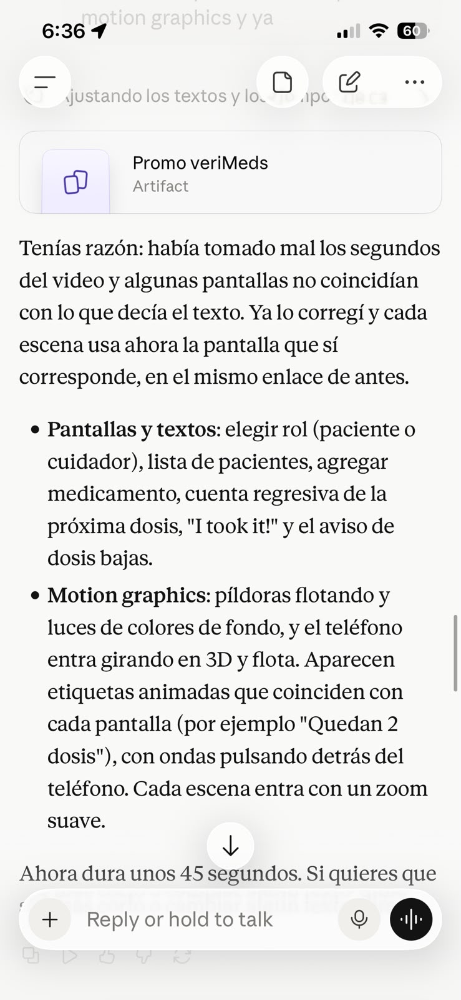

# AI Usage

[← Back to README](README.md)

## Tools

Claude.AI by Anthropic

## Purposes / Usage Cases

Overall Claude was used as a search engine and to identify mistakes in code made by us. It was **NOT** used to generate any sort of text nor code.

### Importing the repository on a different computer

**[Bruno Palacios]** One of the usages was due to an error while importing the repository on a different computer. Using Claude, we narrowed down the problem to an issue in the way Unity was installed in the computer, and the moment we switched devices, without changing anything, the project opened just fine.

### Finding a library to access the device gallery

**[Bruno Palacios]** Another use of Claude was helping in finding libraries that helped during coding. We searched on the internet for a way to access the gallery of a device, since we wanted to add an option to be able to add images onto the medications and users. I was having trouble finding a package that helped with this, so we asked Claude if there was a repository that did this. The response was there was a GitHub repository called Native Gallery by yasirkula. With this package, I searched how it worked and implemented it in our project.

### Merging two GitHub branches

**[Emilio Macias]** Another use of Claude was during a merge of 2 GitHub branches. We ran into a problem on our part where 2 teammates created branches based on the develop, and then afterwards, while trying to merge these branches onto the develop, since there were simultaneous modifications in the main scene, we couldn't merge it. We asked Claude what could be done, but the solution given did not work, so we opted for a manual merge, and moved forward with this methodology.

### Understanding the search bar in Unity

We also had Claude to explain how the search bar worked in Unity, without generating any scripts or code, just an explanation. This explanation helped with implementing the search bar on the Caretaker's view on the user page.

### Markdown formatting

We used Claude's artificial intelligence to help us with the formatting of the Markdown files. Since we had originally written the content in a Google Doc, we used the AI to convert it from PDF to Markdown.

### Promotional video

Finally, Claude was used to generate the promotional video of the project, since this was an AI level 2 Task. Here's exactly what was stated and what was used that was AI generated from it:

