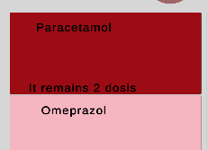
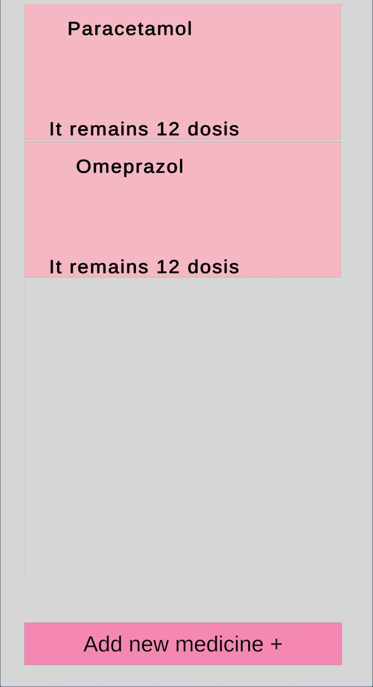
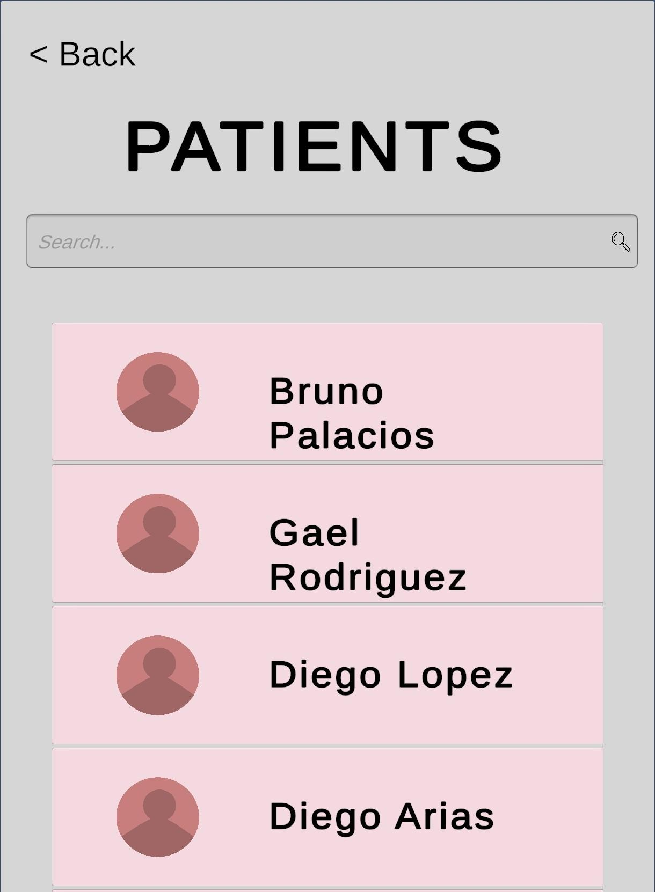

# Design Justification

[← Back to README](README.md)

## 1. Color perception: red card with low doses

- **Decision:** The card turns red when 3 doses or fewer remain.
- **Concept:** Pre-attentive processing, the caregiver detects the problem without reading.
- **A point to consider:** Color alone is not enough for people with color blindness. So, we also send notifications to serve as reminders for the patient and caretaker.

## 2. Cognitive load and progressive disclosure

- **Decision:** Patient list → a patient's medications → details of a specific medication. Each screen displays only what is necessary.
- **Concept:** Cognitive load and chunking (limit of working memory).

## 3. Feedback and visibility of system status

- **Decision:** Upon returning from a modification or addition, the screen updates automatically. The button changes its appearance when pressed.
- **Concept:** The user sees that their action had an effect. Previously, it would update with every tick, but we decided to change it so that it only updates upon receiving new information.

## 4. Consistency

- **Decision:** The "< Back" button is in the same position on all screens, and the medication card and the patient button share the same style.
- **Concept:** Internal consistency, the user learns the pattern once.

